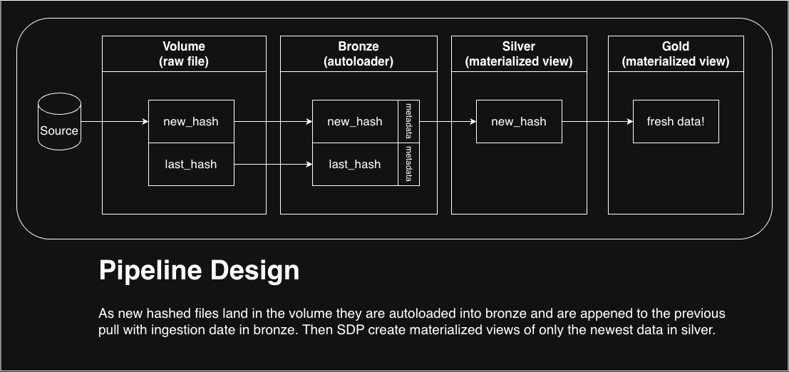

# Architecture

This pipeline is modeled as a medallion architecture.
1. Volumes for raw file landing zone (files require a new hash to be saved and each file gets its own dir)
2. Bronze streaming tables append each new datafile using an Auto Loader (looped dynamically through each dir). No typing all columns are strings.
3. Silver materialized views are where data is typed and validated only saving the latest version of each dataset. 
4. Gold is also materialized views to keep data fresh and avoid needless computation. 

This format keeps bronze ingestion append-only, doesn't write unchanged data to any layer, and gives an auditable bronze layer. Downstream users are only given access to clean and up-to-date gold data with minimal reprocessing. 

It is also idempotent because unchanged files in the source lands no data in the volume, triggering no refresh of the bronze tables because of autoloader checkpointing as well as no-op refreshes refresh of the materialized views in silver or gold. 

I use PySpark throughout this pipeline because the of the dynamic discovery of source files and volume directories. This pipelines relies heavily on reused logic for all tables up to silver. Applying that logic in SQL would be a fragile puzzle box, but is well suited for python. But for the gold layer SQL would work fine and could be more readable for analysts, so depending on the team/culture I might have used SQL for the gold layer. 

# Tradeoffs
1. API pull - On every run we are downloading all files from the API before deciding to land or toss the file. Tradeoff: wasteful download risks getting blocked but ensures changes in the source data are discovered if modified_date isn't updated. 
2. In Bronze I am appending the complete fresh file to the table. I would imagine older versions of this data would not be used often and if they are needed the raw data is in the volume. If this data was refreshed a lot I would not do this. This is a dangerous game in Delta Lake if snapshotting behavior is not watched this can easily explode s3 storage!

# Hardest Thing
As always, it's understanding the data deeply enough to be able to ensure correctness. There can be very nasty details in how data is represented. For example, in this data when looking for the best year it is the default to group by year and call it done, but you need to first remove Q05 which is an average of the 4 quarters, also there can be incomplete years so you must decide if you want a year to includes all four quarters otherwise a very bad quarter that is not populated could produce a skewed confidence. 

Question 2 asks for "the best year, meaning the year with the largest sum of value across all its quarters? (e.g. if PRS30006011 has values 1, 2 in 1995 and 3, 4 in 1996, its best year is 1996 with a summed value of 7.)" This really was tough for me because you implictly ask to sum over years with incomplete quarter data, but I was worried about data quality in those cases and if the resulting reported value would be misleading. Also some series' don't have quarters and just return a Q05 average so in those cases I compare those. Needed to ensure a series is not in both branches. I landed on if ,within a series, if any of Q01–Q04 exist across any year we compare it as a quarter_value_sum, if only Q05's exist then it becomes an annual_average.

Second hardest is defensive programming for an ingestion where you don't own the upstream data. I have no idea how the BLS handles data updates or if this is even the canonical endpoint to be hitting this data from. It looks like this is a fairly stable endpoint (one reference table was last updated in 1994), so I was less concerned but if I owned this I would have set up some page change monitoring. 

# Add-ons
I deployed this as a dab and the job is deployed and ran under a service principle. The dab is automatically deployed via a git workflow so all commits and merges on the main branch will deploy the dab to production. In an enterprise setting branches can be set up to deploy to test/staging/prod along with other controls such as only deploying after a PR request is approved by the proper stakeholders. See the `databricks.yml` and the `.github/workflows/deploy-databricks.yml` for specs. 

# AI Disclosure
1. Architecture was landed on without AI, this is a standard flow of data and AI was not required. 
2. Most steps in the code were written as scratch or pseudocode then polished into the SDP's with AI. 
3. Similar as above with the Gold tables where I wrote out the answers and then asked AI to make them into SDP's in the pipeline. 
4.  Exceptions were AI generated but requirements were text.. I don't like to write exceptions until the pipeline is done or until I understand what needs to be protected. Once I had the pipeline set I worked with AI to generate some minimal exceptions that preserve data important to the gold layer.
5. No part of this PROCESS.md document was touched with AI.